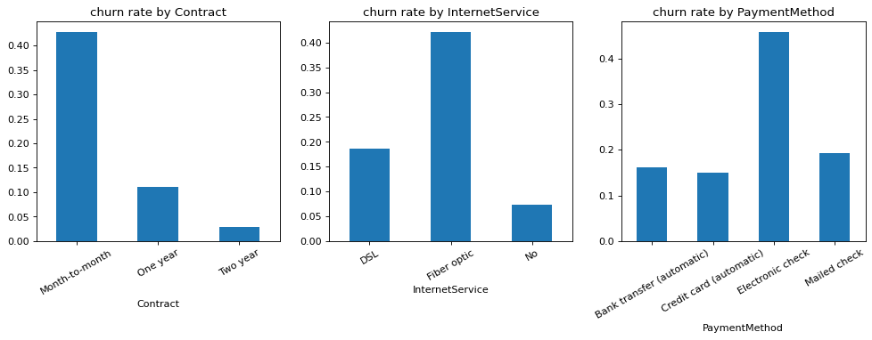

# data-science-agent

An LLM agent that takes a dataset and a task in plain words and works through the full data science cycle on its own: understanding the problem, train/test split, EDA, cleaning and features, baseline, several models with cross-validation and tuning, one final test evaluation, and a written report.

Everything it runs is recorded as a Jupyter notebook, so the analysis can be reviewed and rerun by a person.

## How it works

```
task + data ──> Claude ──> tool call ──> Python kernel / files ──> result (text, figures)
                  ^                                                    │
                  └────────────────────────────────────────────────────┘
                         repeated until the model calls finish
```

- **Model:** Claude through the Anthropic API with tool use. The default is `claude-sonnet-5-5`; set `--model` or `DS_AGENT_MODEL` to change it.
- **Persistent Python kernel:** code runs in a Jupyter kernel, so data and variables stay in memory between steps, like in a notebook. Matplotlib figures are sent back to the model as images, so it can read its own plots.
- **Workflow in the system prompt** ([`ds_agent/prompts.py`](ds_agent/prompts.py)): split before any analysis, EDA on training data only, baseline first, preprocessing inside sklearn Pipelines, cross-validation for model choice, a single evaluation on the test set, leakage checks, fixed seeds.
- **Checkpoints:** after EDA and after the baseline, the agent shows a summary and asks whether to continue or change direction. `--auto` skips the questions.
- **Experiment log:** every model is recorded with its metrics in `outputs/experiments.jsonl`, and the agent sees the leaderboard after each entry.
- **Memory:** reusable lessons (for example "TotalCharges has blank strings") are appended to a Markdown file and included in the prompt of the next run.
- **Context control:** older figures are dropped from the conversation and prompt caching is used, so long runs stay cheap.

### Tools

| tool | what it does |
|---|---|
| `run_python` | run code in the kernel, return output, errors and figures |
| `list_files`, `read_file`, `write_file` | work with files, restricted to the run directory |
| `install_package` | `pip install` into the kernel |
| `log_experiment` | record a model and its validation metrics, return the leaderboard |
| `checkpoint` | ask the user before continuing |
| `save_memory` | store a lesson for future datasets |
| `finish` | write the final report |

## Quick start

```bash
make install                      # creates .venv and installs the package
export ANTHROPIC_API_KEY=...
make demo                         # downloads the Telco churn dataset and runs the agent
```

On your own data:

```bash
ds-agent path/to/train.csv --task "Predict house prices" --target price
ds-agent data/ --task "Find what drives late deliveries" --auto --max-steps 30
```

Each run gets its own directory under `runs/`:

```
runs/<timestamp>/
  data/                  copy of the input files
  outputs/
    report.md            final report
    analysis.ipynb       every step as a notebook cell, with outputs
    experiments.jsonl    all models and metrics
    model.joblib         final fitted pipeline
    figures/             plots
```

### Running in Docker

The agent executes code written by a model. To keep it away from your own files, run it in a container that only sees the current directory:

```bash
make docker-demo
```

## Example run: Telco customer churn

`make demo` runs the agent with `--auto` on the [IBM Telco Customer Churn](https://github.com/IBM/telco-customer-churn-on-icp4d) dataset: 7,043 customers, 26.5% churn. The task given was "Predict which customers will churn, so the retention team can contact the riskiest ones first." The run took 11 model steps.

The full output is in [`examples/telco-churn`](examples/telco-churn): the [report](examples/telco-churn/report.md) written by the agent, the [notebook](examples/telco-churn/analysis.ipynb) with every step, and the experiment log.

Cross-validation on the training set (5 folds):

| model | ROC AUC | PR AUC |
|---|---|---|
| dummy (prior) | 0.500 | 0.265 |
| logistic regression | 0.846 | 0.662 |
| random forest | 0.845 | 0.658 |
| LightGBM, default | 0.844 | 0.656 |
| LightGBM, Optuna (30 trials) | 0.850 | 0.669 |

On the test set the tuned LightGBM got 0.848 ROC AUC and 0.664 PR AUC, against 0.842 and 0.634 for logistic regression. Contacting the top 10% of customers by predicted risk reaches 29% of all churners with precision 0.76.

The agent itself pointed out that the gap between LightGBM and logistic regression (about 0.004 AUC) is smaller than the fold standard deviation (about 0.012), so the two models are close to equivalent here. It also saved this as a lesson in its memory.



## Tests

```bash
make test    # kernel, tools, and the agent loop with a scripted fake model (no API calls)
make lint
```

## Limitations

- Designed for tabular data that fits in memory. Images, text and very large data are not handled yet.
- The agent can still make analytical mistakes. The notebook and the checkpoints exist so a person can catch them.
- The run directory limits file tools, but code in the kernel can reach the rest of the machine. Use Docker for untrusted data.

## Next steps

- SQL tool for reading from PostgreSQL directly
- Time series support with time-based backtesting
- Web interface (Streamlit) instead of the terminal
- Benchmark on several public datasets against human results
